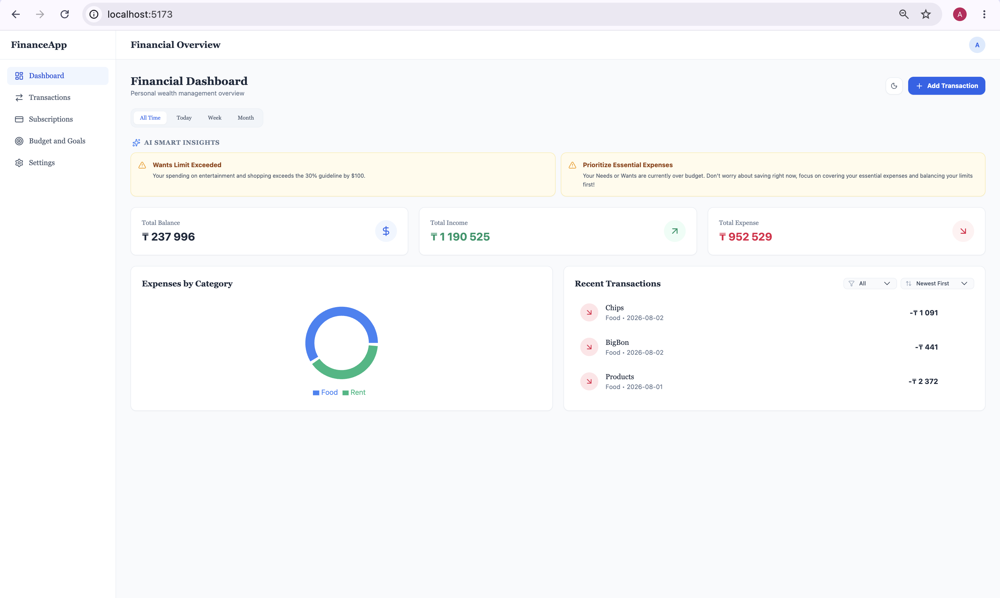
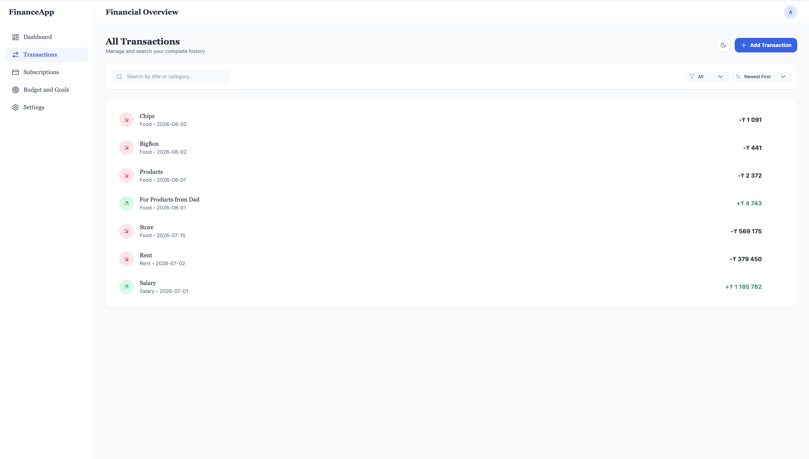
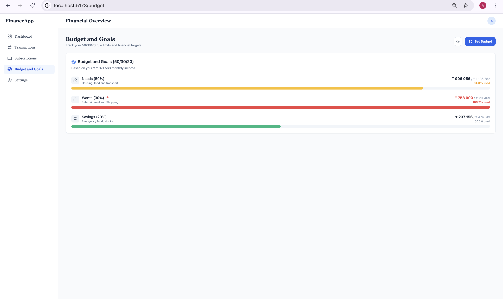
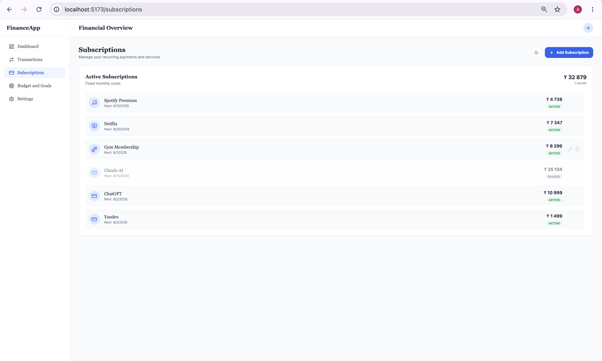
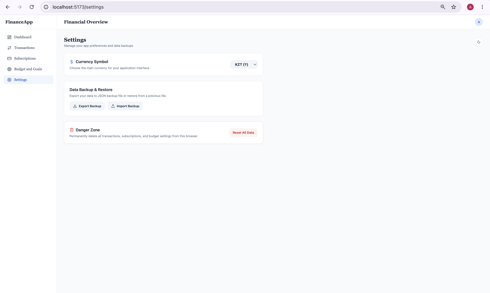
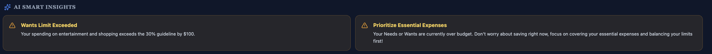
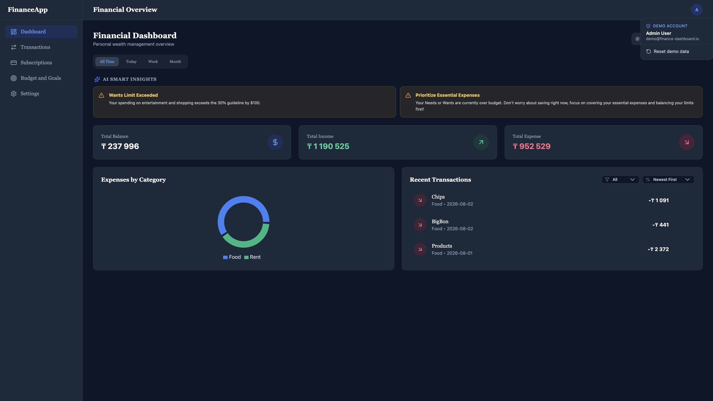

# 💰 Finance Dashboard

A modern personal finance dashboard built with **React**, **TypeScript**, and **Tailwind CSS**.

Track your income and expenses, manage budgets, monitor subscriptions, analyze spending with interactive charts, and receive smart financial insights — all in one responsive dashboard.

---

## 📸 Preview

### Dashboard


### Transactions


### Budget Management


### Subscriptions


### Settings


### Smart Insights


### Dark Mode


---

# ✨ Features

## 📊 Dashboard

- Financial overview
- Total balance
- Monthly income
- Monthly expenses
- Savings tracking
- Interactive analytics

---

## 💸 Transaction Management

- Add transactions
- Edit transactions
- Delete transactions
- Income & Expense types
- Category management
- Currency support
- Date selection

---

## 📈 Analytics

- Expense distribution (Pie Chart)
- Income vs Expense trends
- Monthly statistics
- Time range filters
- Smart financial insights

---

## 🎯 Budget Management

- Category budgets
- Budget progress tracking
- 80% warning indicator
- Overspending detection
- Financial goals

---

## 🔁 Subscription Tracker

Manage recurring payments like:

- Spotify
- Netflix
- Gym
- Internet
- Mobile
- Other subscriptions

Includes:

- Monthly cost
- Next payment date
- Active subscriptions overview

---

## ⚙️ Settings

Customize your dashboard experience:

- Dark / Light theme
- API-managed display currency
- Browser-local theme and exchange-rate cache
- Disabled legacy reset and backup controls
- User preferences

---

## 🌙 User Experience

- Responsive design
- Dark / Light mode
- Modern UI
- Mobile friendly
- Clean component architecture

---

# 📂 Project Structure

```
src/
│
├── components/
├── pages/
├── hooks/
├── types/
├── utils/
├── data/
├── constants/
├── assets/
└── App.tsx
```

---

# ⚙️ Installation

Clone the repository

```bash
git clone https://github.com/ga1ssaa/finance-dashboard.git
```

Go to project

```bash
cd finance-dashboard
```

Install dependencies

```bash
npm install
```

Run development server

```bash
npm run dev
```

Build production version

```bash
npm run build
```

---

# 📱 Responsive Design

The application is optimized for

- 💻 Desktop
- 📱 Mobile
- 📟 Tablet

---

# 🧠 Project Highlights

- Modular architecture
- Reusable components
- Custom React Hooks
- Strong TypeScript typing
- Responsive layout
- Interactive charts
- FastAPI persistence
- Clean UI/UX
- Feature-based organization

---

# 🚀 Future Improvements

- Cloud database
- Multi-currency support
- Export to PDF
- CSV import/export
- Notifications
- Recurring transactions
- AI financial recommendations

---

# 📄 License

This project is licensed under the MIT License.

---

# 👨‍💻 Author

**Gaisa Aldiyar**

Software Engineering Student

Astana IT University

GitHub:
https://github.com/ga1ssaa
## Local full-stack development

### Isolated Docker Compose stack

Docker Desktop / Docker Engine with Compose v2 or newer is required. From the
repository root, generate dedicated secrets once (Python 3, standard library only):

```sh
python3 docker/init-env.py
```

The helper exclusively creates ignored `.env.compose.local` with mode `0600` and
does not print or replace credentials. Variable names are documented in
`.env.compose.example`. Keep the generated hexadecimal database password: it is
also embedded in the container-only SQLAlchemy URL. Do not use `backend/.env`.

Start the entire application with one Compose command:

```sh
docker compose --env-file .env.compose.local up --build -d --wait
```

Open **http://127.0.0.1:8080** (use this exact host, not `localhost`). Nginx serves
the production Vite build and proxies `/api/` unchanged to FastAPI. The existing
frontend requires an absolute loopback API URL; Compose builds it with the same
browser origin. `AVERO_HTTP_PORT` changes both the published port, build-time API
URL and allowed auth origin. Rebuild/recreate after changing that port.

Services: `frontend` (Nginx), `backend` (single-worker FastAPI), `postgres`
(PostgreSQL 17), and the one-shot `migrate` service. PostgreSQL health gates
migrations; successful migrations gate backend startup; backend readiness gates
Nginx startup. Only Nginx publishes a host port, bound to `127.0.0.1`.

The dedicated Compose project is **`avero-local`**, its database is
**`avero_compose`**, and its new persistent volume is
**`avero-local_postgres_phase8_data`**. No host database URL or existing volume is
mounted or reused. The migration wrapper rejects other hosts/database names and
applies the existing Alembic chain through `0004_data_operations` to this isolated
database. The migration approval boundary below still applies to all existing
development databases. `backend/compose.yaml` remains the separate development
database setup. Do not override the Compose project name or run this root stack
with the backend environment file.

This is a **local HTTP stack**, not a production deployment. It deliberately keeps
`APP_ENV=development`, existing cookies/CSRF/origin rules, one API worker and
`--no-proxy-headers`; production mode requires the separate reviewed Heroku configuration in [docs/production.md](docs/production.md). Behind
Nginx, the existing IP rate limits are shared across local users. No auth behavior
or financial contract is changed. Exchange rates still require the existing
external provider; no rates are fabricated by Compose.

Verify without printing resolved secrets:

```sh
docker compose --env-file .env.compose.local config --quiet
python3 docker/test_config.py
docker compose --env-file .env.compose.local ps -a
docker compose --env-file .env.compose.local exec -T postgres sh -c 'psql -U "$POSTGRES_USER" -d "$POSTGRES_DB" -Atc "SELECT current_database(), 1"'
docker compose --env-file .env.compose.local exec -T backend alembic current
python3 docker/smoke.py
```

The smoke script uses only the isolated loopback frontend, a newly registered
synthetic account and transactions created by that run. It checks SPA assets,
proxied API readiness, authentication/CSRF/cookies, exact USD CRUD/aggregates and
logout revocation. It removes only its own transaction IDs; the synthetic account
remains. Pass `--port` if `AVERO_HTTP_PORT` differs from 8080. Container build
contexts use allowlists that exclude host credentials, backups and dependencies.
Never print `docker compose config` without `--quiet`: resolved output contains
secrets. Preserve `.env.compose.local` when reusing the persistent volume; changing
its password does not rotate an initialized database's credentials.

Stop this stack without deleting its persistent volume:

```sh
docker compose --env-file .env.compose.local stop
```

Do not use volume deletion or pruning commands. Existing PostgreSQL services,
`finance_dashboard`, backups and data remain untouched.

### Native development

Financial records, manual budget inputs, and display-currency preferences now use the FastAPI API. Run the backend using [backend/README.md](backend/README.md), then configure and start this frontend:

```bash
cp -n .env.example .env.local
npm install
npm run dev -- --host 127.0.0.1 --port 5173 --strictPort
```

`VITE_API_BASE_URL` defaults to `http://127.0.0.1:8000/api/v1`. Local configuration accepts loopback API URLs; use the backend CORS configuration for a different local frontend port. Public HTTPS deployment uses the separate same-site configuration in [docs/production.md](docs/production.md). Restart Vite after changing its environment. This is a local authenticated application; do not expose this development setup publicly. Use `127.0.0.1` for both Vite and the API (or `localhost` for both) so the host-only refresh cookie works across their ports.

Sign in at `/login` or create an account at `/register`. New registrations start with an empty account. Existing records in the former single-owner namespace are not automatically assigned to registered users.

Access JWTs live only in application memory. Reloading restores the session using the server's HttpOnly refresh cookie. Auth cookie requests include credentials and the required CSRF protection header; ordinary financial requests use the access token. Logout clears the in-memory financial views, drafts, and session and revokes the cookie session. If server logout cannot be confirmed, the app remains gated with a retry action.

Refresh is shared across simultaneous requests in one tab, and cookie-changing operations are serialized. A confirmed authentication rejection may refresh and retry a financial request once. Network failures and ambiguous writes are never automatically retried. Account changes invalidate pending responses before they can populate another account's view.

Multiple tabs share a refresh cookie but do not coordinate refresh rotation. Simultaneous refreshes across tabs may expire the session and require signing in again. Use one active tab for this local setup.

Transactions and subscriptions are paginated and filtered by the server. Dashboard cards and category charts use full-set backend aggregates, and recurring costs use the backend subscription summary. Successful mutations invalidate active views. Offline/API errors show retry controls and never fall back to demo records. Forms remain open with their input on failed saves.

All persisted monetary values are canonical USD decimal strings with up to eight fractional digits. Display currency is an API preference; rates and theme remain browser-local. Transaction, subscription and manual-budget forms freeze their currency, exact rate and publication time when opened. New or changed foreign-currency amounts use BigInt decimal arithmetic and round **once**, at the USD storage boundary, to eight fractional digits using **round-to-nearest, ties-to-even** (banker's rounding). An exact halfway result chooses the even final USD digit; other results choose the nearest representable value. USD input remains exact with at most eight fractional digits. Zero/negative transactions, results below the positive USD minimum after rounding, and amounts above `999999999999.99999999` USD are rejected. There is no intermediate cent rounding. Unchanged or numerically equivalent edit inputs preserve the original USD string, and non-amount PATCHes omit `amount_usd`. Display formatting uses exact decimal multiplication and presentation rounding without changing stored values. Budget PATCHes include only changed monetary fields; subscription non-amount edits omit `amount_usd`. Each unchanged field retains its original USD string, including touch/revert or equivalent formatting. Budget and subscription amounts remain nonnegative (zero is allowed by their existing contracts); positive inputs that round to zero and overflows are rejected. Manual 50/30/20 budget calculations remain independent of transactions.

Exchange-rate numeric tokens are retained as decimal strings. Non-USD conversions require validated USD-base quotes with a provider publication time no older than 36 hours (to accommodate the provider's daily publication cycle). The cache is refreshed after 12 hours, on financial refresh/retry or page reload; saves recheck freshness even if a form has stayed open. Missing, invalid, future-dated, stale or legacy caches never authorize monetary conversions, and no hardcoded non-USD fallback quotes are used. USD remains available without a rate service. A validated in-memory quote remains usable if browser cache writes fail. If a frozen quote expires, reopen after refreshing rates or choose USD; existing records are never reconverted automatically.

Settings → Export Backup downloads the authenticated account's complete financial snapshot from `GET /api/v1/data/export`. The versioned JSON contains canonical USD decimal strings, calendar dates, nullable budget/preferences, and no internal IDs or authentication data. Export uses a consistent read-only snapshot, independent of the current list page. Limits are 10,000 transactions, 1,000 subscriptions and 5 MiB of JSON; oversized exports fail explicitly rather than truncating data. Downloaded files contain unencrypted financial data and should be stored privately.

Settings → Import Backup selects a local JSON file for a read-only preview through `POST /api/v1/data/import/preview`. Version 1 USD files are validated before the account's complete financial state is fingerprinted; the preview shows file counts, current counts, hypothetical replacement impact and warnings. Files are limited to 5 MiB and encoded requests to 10 MiB. Selecting a file or requesting a preview never imports, stages or replaces records. The displayed SHA-256 identifies the document only. A separate signed authorization expires after ten minutes and is bound to the authenticated user/session, document and current financial state.

Import replacement and financial reset require a separate preview, the account password, an exact typed confirmation and a unique operation key. They replace/reset only the signed-in owner's financial resources; account, authentication sessions, other owners and existing receipts remain intact. Successful operations reload financial views and preferences. Uncertain responses keep financial pages paused: check the receipt or explicitly retry the same operation key with the original document and fresh confirmation. A missing receipt does not prove rollback. Never start a different operation while the outcome is unknown.

Recovery metadata is kept only in memory across navigation and account switches. A full browser reload or tab closure loses that metadata. The confirmation and recovery screens display the operation key and warn before submission: retain the key outside the tab if you need later receipt lookup. Do not assume reload cancels a server operation. Passwords, authorization tokens and financial documents are not persisted to browser storage.

**Migration approval boundary:** the new operations and authorization previews require revision `0004_data_operations`. Its migration and complete SQL are prepared offline only; they have not been applied by this implementation task. On `0003_auth`, these routes fail closed before financial changes. Export and ordinary financial CRUD remain available. Do not apply this migration without separate explicit approval and a verified target/preservation preflight.

Existing financial localStorage data is neither imported nor changed. Legacy migration remains disabled. User JSON data operations are separate from the private administrative PostgreSQL backup/restore tools and never invoke them.

Validation (Node.js 24 for the built-in TypeScript test loader):

```bash
npm run lint
npm run build
node --test tests/phase4.test.mjs tests/phase5-auth.test.mjs tests/phase6-export.test.mjs tests/phase6-preview.test.mjs tests/phase6-operations.test.mjs
```

`tests/phase4-api.test.mjs` and its fixture describe the earlier unauthenticated integration phase; they are historical and are superseded by the authenticated Phase 5 checks. Do not point a historical fixture at normal development data.

## Continuous integration

[CI](.github/workflows/ci.yml) runs on pushes to `feat/fullstack`, pull requests
targeting `feat/fullstack` or `main`, and manual dispatch. Four independent jobs
check the frontend, offline backend tests, Docker configuration/images, and
dependency security. Actions are pinned to official immutable commit SHAs;
checkout credentials are not persisted and the token has only `contents: read`.

The frontend uses Node 24, `npm ci`, `node --test tests/*.test.mjs`, ESLint,
TypeScript and the production build. `RUN_PHASE4_E2E=0` keeps the historical
database fixture disabled. Backend CI uses Python 3.13, the declared `[dev]`
dependencies and `python -m pytest -q backend/tests`; `RUN_DATABASE_TESTS=0`
retains all existing opt-in skips and private-fixture guards. A reserved invalid
database hostname is set defensively. CI has no PostgreSQL service, private
environment file, migration execution, backup restore, or database test target.
The migration unit tests generate SQL offline only.

Docker checks use synthetic interpolation values and `.env.compose.example`.
Only `config --quiet`, the eight existing configuration tests and image builds
run; no Compose service is started. The migration image shares the backend
Dockerfile, so only frontend/backend builds are needed. Node/pip download caches
are keyed by `package-lock.json`/`backend/pyproject.toml`.

Security scans the npm lockfile without installing/upgrading packages. Python
requirements are captured from the resolved backend/test environment before the
pinned `pip-audit` tool is installed. There is currently no Python lockfile, so
Python resolution can change within the existing declared ranges. The job summary
lists affected packages, npm severities, Python advisory IDs and available fixes.
`pip-audit` supplies no severity: Python findings are labeled unrated rather than
assigned an invented rating. High/critical npm findings and every Python finding
fail CI; lower npm severities remain reported. Missing, skipped or unavailable
audit data also fail closed. No advisory exclusions or automatic upgrades are
configured. Existing dependency findings may therefore make security CI fail
until a separately reviewed dependency update resolves them.

CI does not publish images, deploy, or use repository/production secrets. Validate
workflow changes with `actionlint .github/workflows/ci.yml` and run the audit
report policy tests with:

```sh
python3 -m unittest discover -s .github/scripts -p 'test_*.py' -q
```

## Production preparation

The Vercel Hobby + Heroku Basic/Essential-0 preparation, security boundaries,
manual new-database migration guard and backup/restore runbook are documented in
[docs/production.md](docs/production.md). No deployment or real migration has been
performed. Local Compose remains isolated and unchanged.
